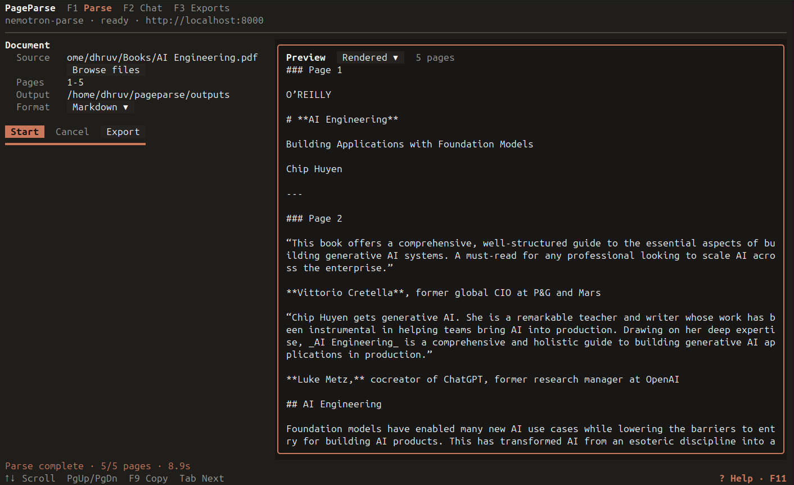

# PageParse

PageParse is a Linux terminal app for parsing PDFs and images with NVIDIA Nemotron 3.5 Parse and chatting with local Ollama models. Preview extracted text and tables, save Markdown or structured JSON, and manage your exports from the same TUI.



*The Parse workspace keeps page selection and export settings beside the preview, so you can review the extracted text before copying or exporting it.*

## Install and run

Install Git, curl, Go 1.25.8 or later, and Python 3.12 with virtual environment support. On Ubuntu, the virtual environment support is packaged as `python3.12-venv`.

```sh
curl -fsSL https://raw.githubusercontent.com/dhruvkshah75/pageparse/main/install-pageparse.sh -o install-pageparse.sh
sh install-pageparse.sh
cd pageparse
./run-pageparse --help
```

The installer clones into `./pageparse`, installs the Python backend dependencies in `.venv`, and builds the Go TUI. Subsequent launches reuse the binary until the Go sources or dependencies change. Pass a directory to use a different location, for example `sh install-pageparse.sh ~/tools/pageparse`. It leaves existing destinations in place. Set `PAGEPARSE_REPO_URL` to install from a fork.

Set up the backend you plan to use once, then run the matching command from the checkout.

| Command | Opens |
| --- | --- |
| `./run-pageparse` or `./run-pageparse --image` | Parse with Nemotron |
| `./run-pageparse --chat` | Chat with Ollama |
| `./run-pageparse --both` | Parse with both backends available |

The launcher opens the TUI immediately and starts selected local servers in the background. Each workspace shows its startup status and enables inference when its server is ready. Compatible services that are already running are reused. **Ctrl+Q** stops the services that this launch started. It also stops a reused local Nemotron server when the launcher can verify it is a vLLM process owned by you. Remote servers and existing Ollama services keep running. Startup logs go to `$XDG_STATE_HOME/pageparse/logs/` or `~/.local/state/pageparse/logs/`.

## Model setup

The installer provides the TUI. Install your chosen runtime and model weights separately.

### Ollama

Install Ollama for Linux and make sure `ollama` is on your PATH. Use the running Ollama service for the first model download. If the service is offline, run `ollama serve` in another terminal for this setup step.

```sh
ollama pull qwen2.5-coder:3b
./run-pageparse --chat
```

Chat prefers that tag when it is installed. Use the Model menu to switch to other installed chat-capable models. Set `OLLAMA_MODELS` if you keep your models in a custom directory. [Ollama Linux setup](https://docs.ollama.com/linux)

### Nemotron

Use the NVIDIA model's vLLM setup for your GPU and CUDA installation. The launcher looks for these paths under `/opt/nemotron` by default:

- `.venv/bin/vllm` for the isolated model server runtime.
- `model/` for the NVIDIA weights, vLLM plugin, and the `nemotron_parse` postprocessing package.
- `hf_cache/` for the Hugging Face cache.

Set `PAGEPARSE_NEMOTRON_ROOT` to use the same layout on another drive. Keep the server environment, GPU packages, and weights outside the lightweight PageParse checkout. Follow NVIDIA's vLLM setup for the correct runtime build. [NVIDIA Nemotron 3.5 Parse setup](https://huggingface.co/nvidia/Nemotron-3.5-Parse#vllm)

With the chosen root writable and a compatible vLLM environment at `$PAGEPARSE_NEMOTRON_ROOT/.venv`, use the Hugging Face CLI to place the model and install its server plugin:

```sh
export PAGEPARSE_NEMOTRON_ROOT=/opt/nemotron
export HF_HOME="$PAGEPARSE_NEMOTRON_ROOT/hf_cache"
hf download nvidia/Nemotron-3.5-Parse --local-dir "$PAGEPARSE_NEMOTRON_ROOT/model"
"$PAGEPARSE_NEMOTRON_ROOT/.venv/bin/python" -m pip install "$PAGEPARSE_NEMOTRON_ROOT/model"
./run-pageparse
```

If you already run a compatible vLLM server, set the API URL, served model ID, and local helper directory using the configuration below.

The launcher binds local vLLM to loopback with one active sequence, an 8,744-token context, and 80% GPU memory utilization. This setup passed parsing checks on a 4 GB RTX 3050. On a small GPU, Ollama can use the CPU for part of its work when both services are active. [Laptop verification results](docs/checkpoints.md)

## Use PageParse

The TUI uses a warm charcoal palette with coral controls and cream text.

| Key | Action |
| --- | --- |
| **F1** | Parse |
| **F2** | Chat |
| **F3** | Exports |
| **F4** | Refresh servers and the export index |
| **F5** | Parse the current source or send a chat message |
| **F6** | Cancel the active parse or stop the chat reply |
| **F7** | Export the current parse result |
| **F8** | Paste an image into Parse |
| **F9** | Copy the current preview, chat transcript, or export details |
| **F10** | Open the full status message or export paths |
| **? / F11** | Open or close the full-screen shortcut guide. You can also click **? Help**. |
| **Alt+?** | Insert a question mark in a text field |
| **Ctrl+C** | Copy the focused input or workspace text |
| **Tab / Shift+Tab** | Move focus between fields, buttons, and output |
| **↑ / ↓** | Move between Parse fields or between choices in an open menu |
| **← / →** | Move between Parse action buttons |
| **Enter / Esc** | Open a menu, select a choice, or close the menu with Esc |
| **Ctrl+Q** | Quit |

**Parse.** Browse or paste a path to a text or scanned PDF, PNG, JPEG, or WebP. Enter `all`, leave Pages blank, or enter a range such as `1,3-5`. Press **F8** to paste an image. On Wayland, install `wl-clipboard` if your desktop blocks the clipboard reader.

**Pass mode.** Choose **Single** for a fast whole-page parse, **Double** to refine predicted tables and charts, or **Triple** to add separate layout detection before refinement. Double and Triple require the NVIDIA multipass helper.

**Copy.** **F9** copies the full output, including off-screen text. In Rendered mode it copies the underlying Markdown. Move focus into a preview or transcript to scroll with **↑/↓** or **Page Up/Page Down**. Copy uses `wl-copy` on Wayland, `xclip` on X11, or OSC 52 when the terminal supports it. To select a portion of visible text, hold **Shift** while dragging in terminals that support bypassing app mouse handling.

**Export.** Choose Markdown, JSON, or both beside the output directory. The default destination is `outputs/` in the launch directory. Markdown uses pipe tables, and JSON preserves the original table spans and pixel coordinates. Partial results require confirmation and use `.partial` filenames. The app never overwrites an existing path.

Open **Filters** or press **Alt+M** in Parse. Use **Space** to toggle **Page header**, **Page footer**, and **Footnote**, then press **Esc** to return. Filters apply to the Markdown file when you export. The preview and JSON retain all parsed blocks.

**Clean up.** Open Exports and press **Space** to select groups. Choose which files to delete and confirm their paths. Exports refreshes after deletion and checks for external deletions while the tab is open. Cleanup verifies the files it created and requires a directory owned by you without group or other write access. For an existing group-writable `outputs/`, run `chmod go-w outputs` from the checkout.

**Chat.** Send a message to the selected model, then ask a follow-up. Stop keeps partial text visible. New chat and model switching clear the transcript. Chat history stays in memory.

## Configuration

| Environment variable | Default | Purpose |
| --- | --- | --- |
| `PAGEPARSE_NEMOTRON_ROOT` | `/opt/nemotron` | Local server installation used by the launcher |
| `PAGEPARSE_VLLM_URL` | `http://localhost:8000/v1` | vLLM API root |
| `PAGEPARSE_NEMOTRON_MODEL` | `nemotron-parse` | Exact served ID for document parsing |
| `PAGEPARSE_NEMOTRON_HELPERS` | `$PAGEPARSE_NEMOTRON_ROOT/model` | Trusted directory containing the NVIDIA helper package |
| `PAGEPARSE_VLLM_API_KEY` | `EMPTY` | Bearer token for vLLM |
| `PAGEPARSE_OLLAMA_URL` | `http://localhost:11434` | Ollama API root |
| `PAGEPARSE_NEMOTRON_MAX_TOKENS` | `4096` | Maximum generation tokens per page |
| `XDG_STATE_HOME` | `~/.local/state` | Base directory for the export index and server logs |

The configured endpoints receive page images and chat prompts for their workspaces. To manage servers yourself, use `./run-pageparse --no-start`, `.venv/bin/pageparse`, or `.venv/bin/python -m pageparse`. Add `--chat` to open Chat first.

## Troubleshooting

| Symptom | Check |
| --- | --- |
| Server fails to start | Open the log path printed by the launcher and check the selected backend's setup. |
| Model missing | Check `/v1/models` for vLLM or run `ollama list` for Ollama. Press F4 after making changes. |
| NVIDIA helper unavailable | Set `PAGEPARSE_NEMOTRON_HELPERS` to the directory containing the shipped `nemotron_parse` package. |
| Context limit or truncated page | Lower the token ceiling on a context rejection. Increase it for truncation if the server context has room. |
| GPU allocation error | Run the single backend you need. A running vLLM service reserves GPU memory even when idle. |
| Export or cleanup error | Use a writable local output directory with hard-link support and no symlink components. Check the state directory permissions and retry a busy index. |

## Development

From a Git checkout:

```sh
python3.12 -m venv .venv
.venv/bin/python -m pip install -e '.[test]'
go test ./...
.venv/bin/python -m pytest -q
./run-pageparse --chat
```

- `cmd/pageparse` contains the Go TUI, built with Bubble Tea, Bubbles, Lip Gloss, and Glamour.
- The private bridge in `pageparse/tui_backend.py` connects the TUI to the existing PDF renderer, model adapters, service launcher, and SQLite export store.
- The deterministic suite uses fixtures and runs without model servers. With both servers running, `.venv/bin/python tests/live_smoke.py` exercises the real backends with generated inputs.
- Keep GPU packages in the separate Nemotron environment. See the [specification](SPEC.md), [implementation plan](docs/implementation-plan.md), and [verification results](docs/checkpoints.md) for behavior and test coverage.
